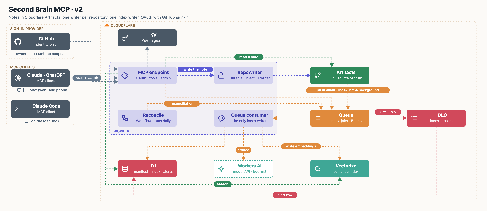
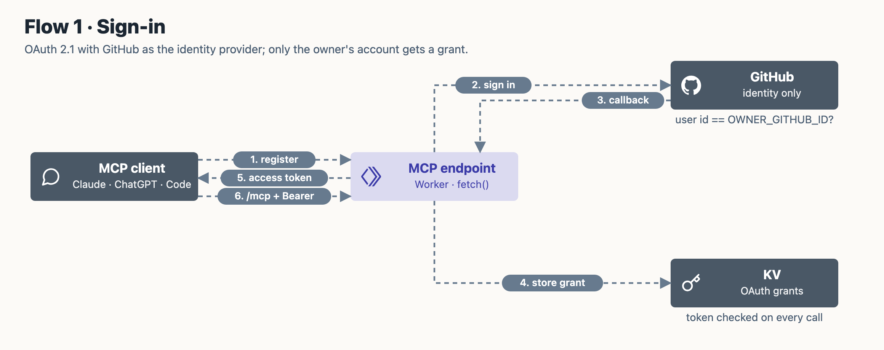
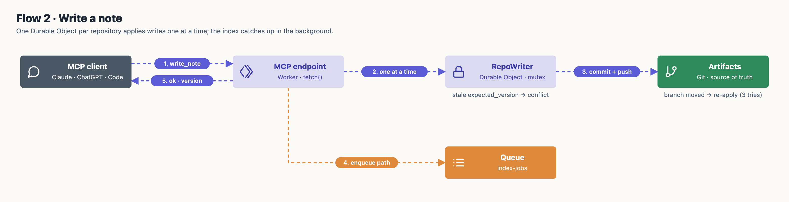
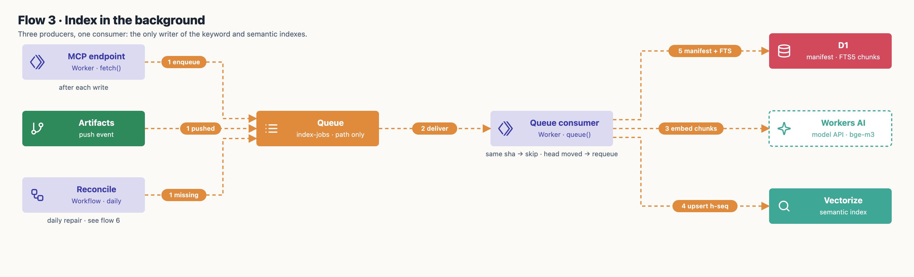
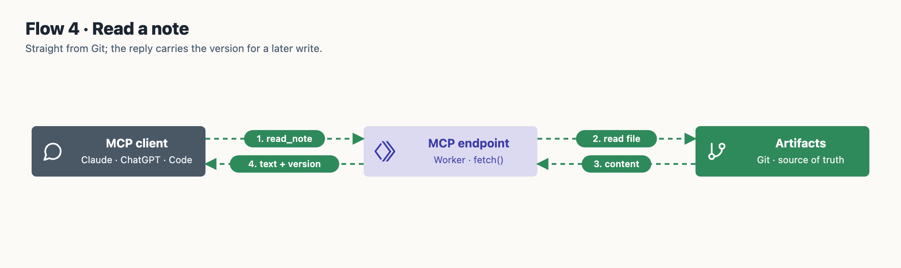
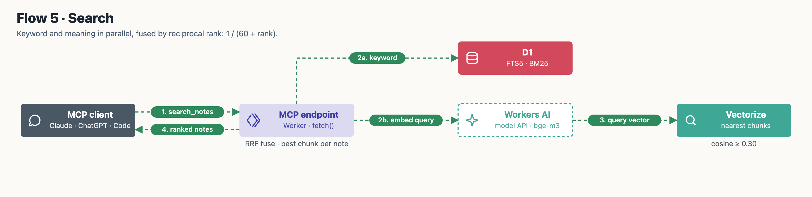
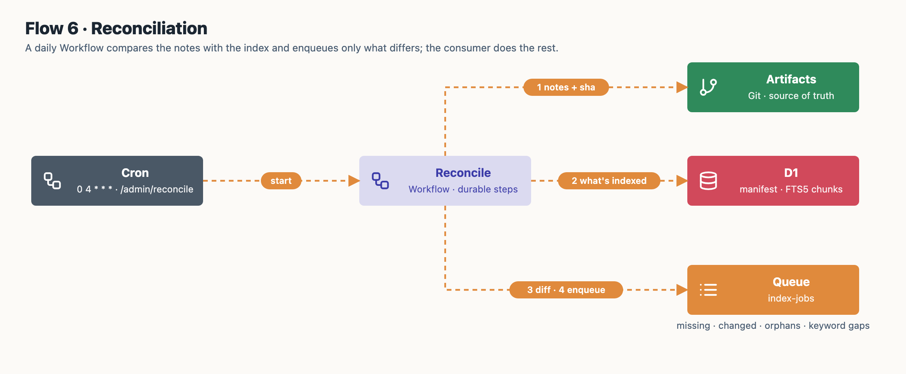
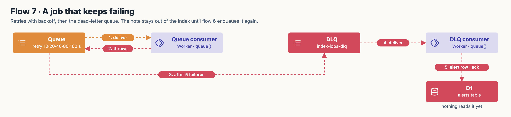

# Architecture (v2)



| Concern | How | Decision |
|---|---|---|
| Where notes live | Cloudflare **Artifacts** (Git), read through a binding | [ADR 007](docs/adr/007-cloudflare-artifacts-for-the-notes.md) |
| Writes | One **Durable Object per repository**: in-memory mutex, operation applied inside the lock, retried on the new tip if another push landed first, confirmed before reporting a failure | [ADR 008](docs/adr/008-one-durable-object-per-repository.md) |
| Indexing | A **Queue**: the only writer of the index, retries and a dead-letter queue, records what it indexed in a **D1 manifest** | [ADR 009](docs/adr/009-queue-for-indexing-workflow-for-reconciliation.md), [ADR 010](docs/adr/010-index-manifest-in-d1.md) |
| Repair | A daily **Workflow** compares notes and index and enqueues fixes; also a full rebuild | [ADR 009](docs/adr/009-queue-for-indexing-workflow-for-reconciliation.md) |
| Search | **D1 FTS5** (keyword) + **Vectorize** (meaning, Workers AI bge-m3), fused by reciprocal rank, in one tool (`search_notes`) | [ADR 002](docs/adr/002-semantic-search-with-workers-ai-and-vectorize.md), [ADR 012](docs/adr/012-hybrid-search-with-d1-fts5.md), [ADR 015](docs/adr/015-one-search-tool.md) |
| Access | **OAuth 2.1** (`workers-oauth-provider`), consent page, GitHub sign-in restricted to the owner | [ADR 011](docs/adr/011-oauth-with-github-login.md) |
| Clients | Every client, Claude Code on the Mac included, reads and writes only through MCP; an optional read-only mirror for viewing | [ADR 014](docs/adr/014-mcp-only-clients.md) |
| Infrastructure | `wrangler.jsonc` + an idempotent setup script; deploy on merge | [ADR 006](docs/adr/006-wrangler-and-a-setup-script-instead-of-terraform.md) |

**Limits of this design.** All writes to one repository go through one Durable Object, about two writes per second from the spike's measurements; a team would shard by repository ([at scale](docs/design/at-scale.md)). A missed push event waits for the daily reconciliation, so the index can lag by up to a day, never stay wrong.

## Flows

### 1. Sign-in

<p align="center"></p>

### 2. Write a note

<p align="center"></p>

### 3. Index in the background

<p align="center"></p>

### 4. Read a note

<p align="center"></p>

### 5. Search

<p align="center"></p>

### 6. Reconciliation

<p align="center"></p>

### 7. A job that keeps failing

<p align="center"></p>

## Repository

```
src/
  index.ts            Worker: OAuth wrapper, MCP tools, admin routes, queue handler
  auth/github.ts      consent page, GitHub sign-in, owner check
  writer/             RepoWriter Durable Object, Artifacts working copy (isomorphic-git)
  indexer/            queue consumer logic and adapters (Artifacts, D1, Vectorize, Workers AI)
  reconcile/          reconciliation Workflow
  search/hybrid.ts    FTS5 query building and rank fusion
migrations/           D1 schema
scripts/              setup, secrets, read-only mirror, measurements
test/                 Vitest (inside workerd) and shell tests for the scripts
docs/                 PRDs, specs, ADRs, architecture maps, measurements, design notes
```
