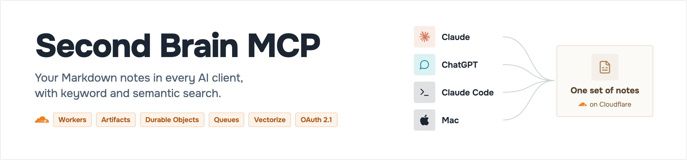

<p align="center"></p>

<p align="center"><a href="https://github.com/YudiG12/second-brain-mcp/actions/workflows/ci.yml"></a>    <a href="LICENSE"></a> </p>

**A remote MCP server that gives every AI client the same Markdown notes**: Claude Code on the Mac, Claude on the web and phone, ChatGPT. Search by keyword or by meaning; every change is a Git commit. Deploy your own on Cloudflare.

<p align="center"></p>

<p align="center"><sub>A simplified view. Every component, with the decision behind it: <a href="ARCHITECTURE.md">ARCHITECTURE.md</a>.</sub></p>

## Deploy your own

Needs a Cloudflare account on the [Workers Paid](https://developers.cloudflare.com/workers/platform/pricing/) plan, Node 24 and git.

```sh
git clone https://github.com/YudiG12/second-brain-mcp && cd second-brain-mcp
npm ci && npm run deploy-your-own
```

Optional, sync a local clone on your Mac:

```sh
npm run mac-hook
```

## How to use

Claude Code:

```sh
claude mcp add --transport http second-brain https://<your-worker>.workers.dev/mcp
```

Claude (web, desktop, phone) and ChatGPT: add a custom connector with `https://<your-worker>.workers.dev/mcp`.

Then ask:

```
What did I decide about the Acme proposal?
Save this idea: …
In the plan note, change the deadline to Friday.
```

## Links

- [ARCHITECTURE.md](ARCHITECTURE.md): the low-level design, every component with the decision behind it
- [Decisions (ADRs)](docs/adr/) · [Spec v2](docs/spec/v2.md) · [PRD v2](docs/prd/v2.md)
- [Performance](docs/measurements/README.md): v1 vs v2, measured in production
- [At scale](docs/design/at-scale.md): what changes for a team
- [CHANGELOG](CHANGELOG.md) · [Contributing](CONTRIBUTING.md) · [Security](SECURITY.md) · [MIT license](LICENSE)
