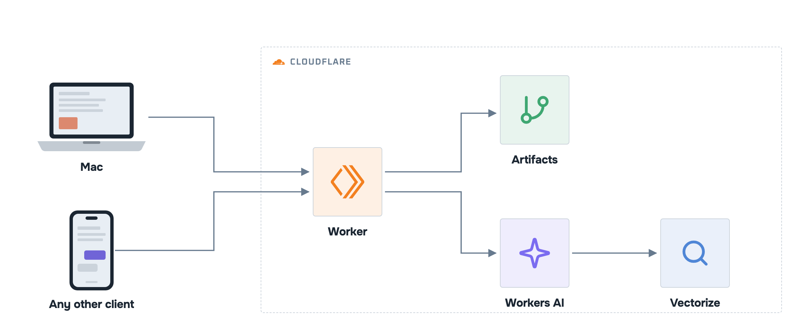

<p align="center"><a href="https://www.youtube.com/@yudiganeko"></a></p>

<p align="center"><a href="https://github.com/YudiG12/second-brain-mcp/actions/workflows/ci.yml"></a>    <a href="LICENSE"></a> </p>

**A remote MCP server that gives every AI client the same Markdown notes**: Claude Code on the Mac, Claude on the web and phone, ChatGPT. Search by keyword or by meaning; every change is a Git commit. Deploy your own on Cloudflare.

<p align="center"></p>

## Deploy your own

Needs a Cloudflare account on the [Workers Paid](https://developers.cloudflare.com/workers/platform/pricing/) plan, Node 24 and git. No Homebrew or sudo (a second user on a Mac, say)? Install Node with [nvm](https://github.com/nvm-sh/nvm), [fnm](https://github.com/Schniz/fnm) or the [nodejs.org tarball](https://nodejs.org/en/download) in your home folder, and keep it on the `PATH` for `npx wrangler login` too.

A second deployment in the same Cloudflare account (`--name` with another name) gets its own D1, index, notes, queues, workflow and OAuth store; it shares nothing with the first.

```sh
git clone https://github.com/YudiG12/second-brain-mcp && cd second-brain-mcp
npm ci && npm run deploy-your-own
```

Or ask your AI coding agent:

```txt
Clone https://github.com/YudiG12/second-brain-mcp and deploy it for me, following its AGENTS.md.
```

Every client, Claude Code on the Mac included, reads and writes only through the MCP tools ([ADR 014](docs/adr/014-mcp-only-clients.md)). Optional, a read-only copy of the notes in a folder, to view them in Obsidian:

```sh
scripts/secrets.sh hook && npm run mirror -- ~/notes
```

Don't edit that folder: each run resets it. Run it on a schedule (launchd or cron) to keep it fresh.

## How to use

The installer prints your `<PUBLIC_URL>`. Claude Code:

```sh
claude mcp add -s user --transport http <worker-name> <PUBLIC_URL>/mcp
```

Claude (web, desktop, phone) and ChatGPT: add a custom connector with `<PUBLIC_URL>/mcp`.

Keyword search sees a change in seconds. Search by meaning is eventually consistent: after a save, edit or move it can take a minute or two to find the new text (and to stop finding the old path).

Then ask:

```
What did I decide about the Acme proposal?
Save this idea: …
In the plan note, change the deadline to Friday.
```

## Links

- [Architecture](ARCHITECTURE.md)
- [Decisions (ADRs)](docs/adr/) · [Spec v2](docs/spec/v2.md) · [PRD v2](docs/prd/v2.md)
- [Performance](docs/measurements/README.md)
- [At scale](docs/design/at-scale.md)
- [CHANGELOG](CHANGELOG.md) · [Contributing](CONTRIBUTING.md) · [Security](SECURITY.md) · [MIT license](LICENSE)
