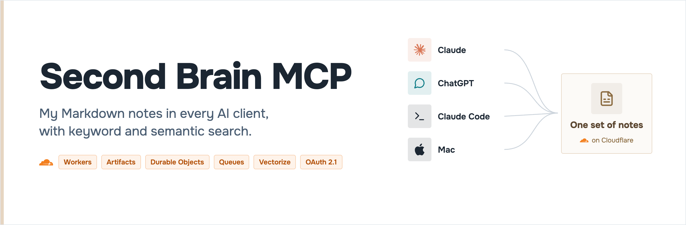
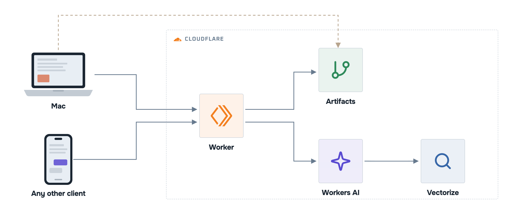

    

**A remote MCP server that gives every AI client the same Markdown notes**: Claude Code on the Mac, Claude on the web and phone, ChatGPT. Search by keyword or by meaning; every change is a Git commit. Deploy your own on Cloudflare.

## Deploy your own

Each deployment serves one person: your notes, your Cloudflare account, and only your GitHub account can sign in. You need a Cloudflare account on the Workers Paid plan, Node 24 or later, and a GitHub account.

1. **Fork and install.** `npm ci`, then `npx wrangler login`.
2. **Point it at your account.** Today the owner's values are spread over a few files; replace them with yours:
   - `wrangler.jsonc`: `account_id`, and in `vars` `PUBLIC_URL`, `CF_ACCOUNT_ID`, `OWNER_GITHUB_ID` (your numeric GitHub id: `gh api user --jq .id`);
   - `scripts/setup.sh`: `ACCOUNT_ID` and `SUBDOMAIN`; `scripts/secrets.sh`: `WORKER_URL`.
3. **Create a GitHub OAuth app** (Settings → Developer settings → OAuth Apps) with the callback `<PUBLIC_URL>/callback`. Put its client id in `GITHUB_CLIENT_ID`.
4. **Create the resources.** `scripts/setup.sh` creates the Vectorize index, the Artifacts repository, the D1 database, the queues and the push subscription. It is safe to run again; copy the D1 id it prints into `wrangler.jsonc`.
5. **Add your notes.** Push your Markdown notes to the Artifacts repository once (the [setup guide](docs/setup.md) has the token command). Starting empty also works.
6. **Deploy and set secrets.** `npx wrangler deploy`, then `scripts/secrets.sh github-oauth` and `scripts/secrets.sh admin`.
7. **Build the index.** `POST <PUBLIC_URL>/admin/reconcile?mode=rebuild` with `Authorization: Bearer <ADMIN_SECRET>`.
8. **Optional, a Mac clone.** `scripts/secrets.sh hook`, copy `clients/claude-code/notes-sync.sh` to `~/.claude/hooks/`, set `SECOND_BRAIN_URL` (your `PUBLIC_URL`) and `NOTES_DIR` (your clone), and merge `clients/claude-code/settings.hooks.json` into your Claude Code settings ([details](clients/claude-code/README.md)).

Every command, in order: [docs/setup.md](docs/setup.md).

## How to use

Add your server as a remote MCP connector in each client, then sign in with GitHub on the consent page. The address is your `PUBLIC_URL` plus `/mcp`:

| Client | Where |
|---|---|
| Claude (web, desktop, phone) | Settings → Connectors → Add custom connector |
| ChatGPT | Settings → Connectors → Create (developer mode) |
| Claude Code | `claude mcp add --transport http second-brain <PUBLIC_URL>/mcp` |

Then just ask. The client picks the tool:

| You ask | Tool |
|---|---|
| "What did I decide about the Acme proposal?" | `search_notes` (keyword + meaning) |
| "Save this idea: …" | `save_idea` |
| "Read projects/acme.md" | `read_note`, `list_notes` |
| "In the plan note, change the deadline to Friday" | `edit_note` (also `write_note`, `move_note`, `delete_note`) |

Each client gets its own grant, which expires and can be revoked ([SECURITY.md](SECURITY.md)).

## Links

- [Low-level design](docs/architecture/README.md): every component, with the decision behind it
- [Decisions (ADRs)](docs/adr/) · [Spec v2](docs/spec/v2.md) · [PRD v2](docs/prd/v2.md)
- [Performance](docs/measurements/README.md): v1 vs v2, measured in production
- [At scale](docs/design/at-scale.md): what changes for a team
- [CHANGELOG](CHANGELOG.md) · [Contributing](CONTRIBUTING.md) · [Security](SECURITY.md)
