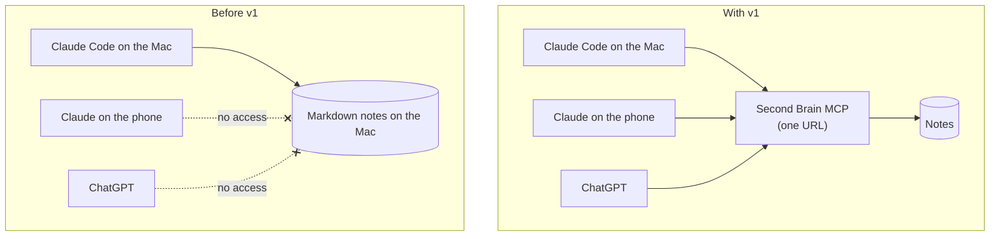
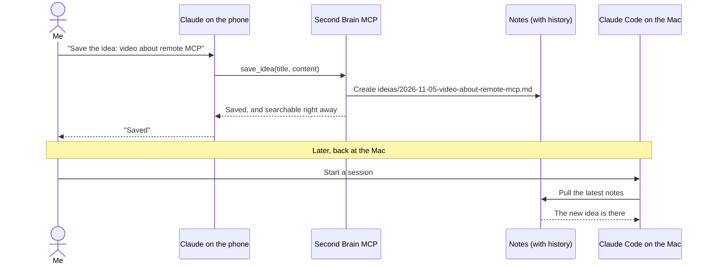

# PRD: Second Brain MCP v1

| | |
|---|---|
| **Status** | Shipped on 2026-11-05 |
| **Author** | Yudi Ganeko |
| **Note** | Written after v1 shipped, to record its scope before planning v2 |

## Problem

My second brain is a folder of Markdown notes: decisions, projects and ideas. Until v1, only the AI agents running on my Mac (Claude Code) could read it. That left three gaps:

1. **No access away from the Mac.** From my phone, claude.ai or ChatGPT, the AI couldn't see any of my notes.
2. **Ideas captured elsewhere were lost.** There was no way to save an idea from my phone and have it show up in my notes.
3. **Search was keyword only.** `grep` finds names and acronyms, but not answers to open questions like "what did I decide about the interview project?".

## Context: before and after

## Users

One user: me. I reach the notes through three MCP clients: Claude Code on the Mac, Claude on the phone (and claude.ai), and ChatGPT.

## Goals

| ID | Goal |
|---|---|
| G1 | Reach the same notes from any MCP client with a single URL. |
| G2 | Find notes both by exact terms and by meaning. |
| G3 | Create, edit, move and delete notes from any client, with changes flowing back to the Mac. |
| G4 | Never lose a note: every change can be undone. |
| G5 | Near-zero cost and no servers to operate. |

## Non-goals for v1

- More than one user, and per-document permissions.
- Real authentication (OAuth).
- A UI. The AI client is the interface.
- Sources other than my notes (email, Slack, Drive).
- Real-time search. A delay of about a minute is acceptable.

## User stories

1. From my phone, I ask "what did I decide about X?" and the answer cites the right note.
2. From my phone, I dictate an idea; it becomes a note and appears on my Mac in the next session.
3. The agents on my Mac search my notes by meaning, not only with `grep`.
4. I edit, move or delete a note from any client, and I can undo it.

### Story 2, step by step

## Requirements

### Functional

| ID | Requirement |
|---|---|
| FR1 | List notes (optionally by folder) and read a note by path. |
| FR2 | Keyword search across notes, ignoring accents and case. |
| FR3 | Semantic search returning the closest passages with their note path. |
| FR4 | Save an idea as a new dated note. |
| FR5 | Write, edit a passage of, move and delete any note. |
| FR6 | Every change to the notes, from any source, is reflected in search, including deletions. |
| FR7 | Rebuild the whole search index on demand. |

### Non-functional

| ID | Requirement |
|---|---|
| NFR1 | Access requires a secret token; without it the server answers 404. |
| NFR2 | Every write is a Git commit, so every change is recoverable. |
| NFR3 | The search index is derived data and can be rebuilt from the notes at any time. |
| NFR4 | A change shows up in semantic search about a minute after it is pushed. |
| NFR5 | Indexing is idempotent: running it again never duplicates results. |
| NFR6 | Runs within Cloudflare's free tiers at my volume. |

## Success criteria

- The same server works in Claude Code, Claude mobile and ChatGPT with no client-specific changes. **Met.**
- A note deleted from the repo disappears from semantic search after the next push. **Met** (this failed in the first R2-based version and drove the move to GitHub; see ADR 001).
- An idea saved from the phone appears in my local notes in the next session. **Met.**
- Monthly cost stays within free tiers. **To confirm in the spec** with the actual usage numbers.

## Known limitations

- **Token in the URL.** Anyone with the URL can read, edit and delete notes. Mitigated by Git history (anything can be restored); fixed properly by OAuth in v2.
- **Keyword search reads every note on each call.** Fine for dozens of notes, too slow for thousands.
- **Eventual consistency.** Semantic search lags about a minute behind a push.

## Next: v2 candidates

v1 has no automated tests, no CI, and its infrastructure was created by hand. v2 covers both engineering and product:

- **Engineering:** automated tests, CI, infrastructure as code with Terraform, and English names for every resource (Worker, index, notes repo).
- **Product:** move the notes from GitHub to Cloudflare Artifacts; OAuth instead of the token in the URL; hybrid search (keyword and semantic in one ranked result).

## Related

- Spec v1 (next)
- ADRs 001–006 (next)
