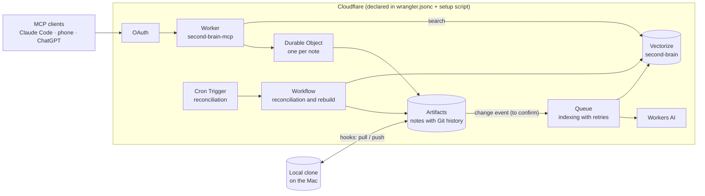

# PRD: Second Brain MCP v2

| | |
|---|---|
| **Status** | Draft |
| **Author** | Yudi Ganeko |
| **Milestone** | [v2](https://github.com/YudiG12/second-brain-mcp/milestone/1) |
| **Builds on** | [PRD v1](v1.md), [Spec v1](../spec/v1.md), [ADRs](../adr/) |

## Problem

v1 works: the same notes are reachable from every AI client, searchable by keyword and by meaning. Documenting it surfaced four kinds of problems:

1. **No safety net.** No automated tests, no CI, and infrastructure created by hand with one-off commands. Any change is verified manually, and the system can't be rebuilt from the repo.
2. **Correctness gaps.** A concurrent edit can be silently lost ([#5](https://github.com/YudiG12/second-brain-mcp/issues/5)); `move_note` isn't atomic ([#10](https://github.com/YudiG12/second-brain-mcp/issues/10)).
3. **Silent failures.** A failed webhook is never retried, a missed deletion stays in the index forever, `/reindex` never cleans up, and the sync hook can stop without an error ([#6](https://github.com/YudiG12/second-brain-mcp/issues/6), [#7](https://github.com/YudiG12/second-brain-mcp/issues/7), [#8](https://github.com/YudiG12/second-brain-mcp/issues/8), [#15](https://github.com/YudiG12/second-brain-mcp/issues/15), [#16](https://github.com/YudiG12/second-brain-mcp/issues/16)).
4. **Limits of the v1 choices.** A token in the URL gives full, permanent access to whoever has it ([ADR 004](../adr/004-secret-token-in-the-url.md)); GitHub is an external dependency capped at 5,000 requests per hour ([ADR 001](../adr/001-github-as-source-of-truth.md)); keyword search reads every note on each call ([#13](https://github.com/YudiG12/second-brain-mcp/issues/13)).

## Users

Still one user, me, through the same three clients. v2 doesn't add users; it makes the system correct, recoverable and ready to grow.

## Goals

| ID | Goal | Issues |
|---|---|---|
| G1 | Every change is tested automatically before it ships. | [#23](https://github.com/YudiG12/second-brain-mcp/issues/23), [#24](https://github.com/YudiG12/second-brain-mcp/issues/24), [#11](https://github.com/YudiG12/second-brain-mcp/issues/11) |
| G2 | The whole infrastructure can be recreated from the repo; every name is in English. | [#25](https://github.com/YudiG12/second-brain-mcp/issues/25) |
| G3 | No edit is ever lost, and every multi-step write is all or nothing. | [#5](https://github.com/YudiG12/second-brain-mcp/issues/5), [#10](https://github.com/YudiG12/second-brain-mcp/issues/10) |
| G4 | No failure is silent: failed work is retried, and anything missed is found and fixed. | [#6](https://github.com/YudiG12/second-brain-mcp/issues/6), [#7](https://github.com/YudiG12/second-brain-mcp/issues/7), [#8](https://github.com/YudiG12/second-brain-mcp/issues/8), [#15](https://github.com/YudiG12/second-brain-mcp/issues/15), [#16](https://github.com/YudiG12/second-brain-mcp/issues/16) |
| G5 | Access requires a real login that can expire and be revoked. | [#12](https://github.com/YudiG12/second-brain-mcp/issues/12) |
| G6 | The notes live inside Cloudflare, without an external token or rate limit. | [#26](https://github.com/YudiG12/second-brain-mcp/issues/26) |
| G7 | Search stays fast as the notes grow, and combines keyword and meaning. | [#13](https://github.com/YudiG12/second-brain-mcp/issues/13) |
| G8 | Decisions are backed by measurements: indexing latency and monthly cost. | [#9](https://github.com/YudiG12/second-brain-mcp/issues/9), [#14](https://github.com/YudiG12/second-brain-mcp/issues/14) |

## Non-goals for v2

- More than one user, and per-document permissions. OAuth here is for one user; authorization comes only if the system is shared.
- A UI.
- Sources other than my notes (email, Slack, Drive).

## Target architecture

Each tool where it fits: a **Queue** for indexing each change (many short, identical jobs, with retries and a dead-letter queue), and a **Workflow** for reconciliation and rebuilds (long, multi-step runs that resume from the step that failed). Parts marked "to confirm" depend on what Artifacts provides; they will be settled in the v2 spec and an ADR.

## Requirements

### Engineering

| ID | Requirement |
|---|---|
| E1 | Tests cover every tool, chunking, leftover cleanup, the webhook (or its replacement) and one regression test per bug fixed in v2. |
| E2 | Every PR runs typecheck and tests; merging to `main` deploys. |
| E3 | `wrangler.jsonc` and an idempotent setup script create every resource; secrets never live in the repo ([ADR 006](../adr/006-wrangler-and-a-setup-script-instead-of-terraform.md)). |
| E4 | Every resource has an English name; the Workers subdomain is `yudiganeko`. The new Worker gets a new secret and the v1 token is retired; once OAuth (P6) lands, OAuth protects the MCP routes and the secret only guards admin routes such as `/reindex`. |
| E5 | Every PR that changes behavior updates the affected docs in the same PR. |

### Product and fixes

| ID | Requirement |
|---|---|
| P1 | Concurrent edits to the same note are serialized; none is lost. |
| P2 | Moving a note is a single atomic change. |
| P3 | Indexing failures are retried, and repeated failures land in a dead-letter queue that alerts. Direction: Cloudflare Queues for per-change indexing. |
| P4 | A scheduled reconciliation re-indexes changed notes and removes vectors of deleted ones; a rebuild removes everything that shouldn't be there. Direction: a Cloudflare Workflow, so a long run resumes from the step that failed. |
| P5 | Sync hook failures are visible, and concurrent sessions don't collide. |
| P6 | MCP access uses OAuth; unauthenticated requests get `401` so clients can start the login flow. |
| P7 | The notes are stored in Artifacts with full history. |
| P8 | Keyword and semantic results come back as one ranked list, without reading every note per query. |
| P9 | Indexing latency and monthly cost are measured and recorded in the v2 spec. |

## Priority

v2 includes everything above. If time runs short, this is the order, so whatever is left out is a choice and not an accident:

1. Tests and CI (E1, E2): the safety net for everything else.
2. Reproducible infrastructure and English names (E3, E4).
3. Measurements (P9): cheap, and they inform P3 and the indexing design.
4. Artifacts (P7): the fixes below depend on the storage backend and its change events, so it comes first to avoid building them twice. It starts with a time-boxed spike (half a day) that answers the Artifacts open questions and ends in a go/no-go. If it is a no-go, P1–P5 are built on GitHub and Artifacts moves to v3.
5. Correctness and resilience fixes (P1–P5).
6. OAuth (P6).
7. Hybrid search (P8).

## Success criteria

- CI is green on `main`, and each v2 bug fix has a test that fails on v1 and passes on v2.
- The infrastructure can be recreated with the setup script, `wrangler deploy` and the documented secret steps.
- Two concurrent edits to the same note both survive.
- A deletion made while indexing is down disappears from search after the next reconciliation.
- All three clients reconnect and work through OAuth.
- Indexing latency and monthly cost are written down with real numbers.

## Open questions

- What are the Artifacts limits, how does it notify changes, and how do the Mac clone and hooks connect to it?
- Reconciliation: Vectorize can list ids only through the REST API and Wrangler (`list-vectors`, [Cloudflare changelog](https://developers.cloudflare.com/changelog/post/2025-08-26-vectorize-list-vectors/)), not the binding. Direction: a manifest table in D1; to be settled in an ADR.

## Related

- [PRD v1](v1.md)
- [Spec v1](../spec/v1.md)
- [ADRs](../adr/)
