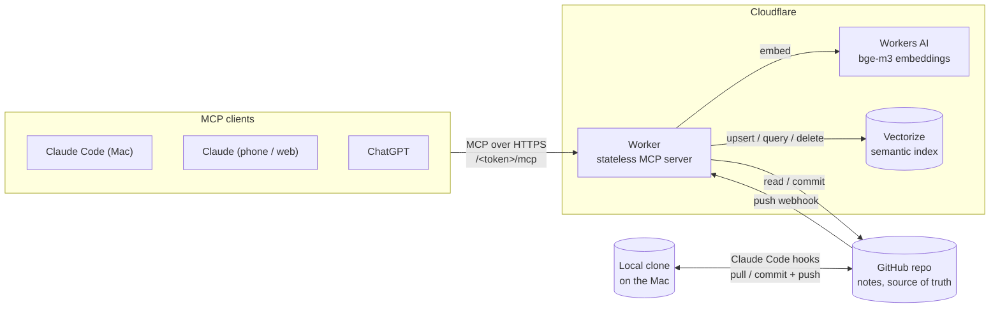
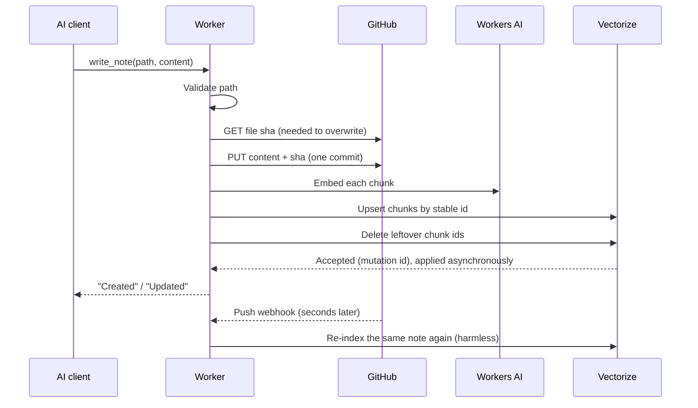

# Spec: Second Brain MCP v1

| | |
|---|---|
| **Status** | Shipped on 2026-11-05 |
| **Author** | Yudi Ganeko |
| **Scope** | How v1 works, exactly as deployed. Changes belong to the v2 spec. |
| **PRD** | [PRD v1](../prd/v1.md) |
| **Decisions** | [ADR 001](../adr/001-github-as-source-of-truth.md), [ADR 002](../adr/002-semantic-search-with-workers-ai-and-vectorize.md), [ADR 003](../adr/003-sync-with-claude-code-hooks-and-a-push-webhook.md), [ADR 004](../adr/004-secret-token-in-the-url.md), [ADR 005](../adr/005-one-commit-per-edit.md) |

## 1. Architecture

| Component | Role |
|---|---|
| **Worker** (`src/index.ts`) | MCP server with 9 tools, the GitHub webhook receiver and the reindex endpoint. Stateless: every request reads what it needs from GitHub or Vectorize. |
| **GitHub repo** (`YudiG12/segundo-cerebro`, private) | Stores the notes as Markdown. Source of truth: every change is a commit. |
| **Workers AI** (`@cf/baai/bge-m3`) | Turns text into a 1024-dimension vector. Multilingual, because the notes are in Portuguese. |
| **Vectorize** (`segundo-cerebro`, 1024 dimensions, cosine) | Semantic index over the notes. Derived data: it can be rebuilt from GitHub at any time. |
| **Local clone** (`~/dev/agentes/cerebro/notas`) | Where the agents on the Mac read and write notes. Kept in sync with GitHub by Claude Code hooks. |

## 2. Endpoints

All routes live under a secret prefix: `/<MCP_TOKEN>/...`. Any request without the exact prefix gets `404 Not found`, as if the Worker didn't exist.

| Route | Method | Caller | What it does |
|---|---|---|---|
| `/<token>/mcp` | MCP (Streamable HTTP) | AI clients | Serves the MCP tools. |
| `/<token>/github-webhook` | `POST` | GitHub | Re-indexes the notes changed by a push. |
| `/<token>/reindex` | `POST` | Me, manually | Re-indexes every note in the repo. Returns `{ notes, chunks }`. |

## 3. Tools

| Tool | Input | Behavior | Writes |
|---|---|---|---|
| `list_notes` | `prefix?` | Lists the paths of every `.md` file, optionally under a folder. | — |
| `read_note` | `path` | Returns the full note. | — |
| `search_notes` | `query` | Keyword search, ignoring accents and case. A line matches when it contains **every** term. Returns up to 40 `path:line: text` hits. | — |
| `semantic_search` | `query`, `topK?` (1–10, default 5) | Embeds the query and returns the closest chunks with score, path and text. | — |
| `save_idea` | `title`, `content` | Creates `ideias/YYYY-MM-DD-<slug>.md` (date in Brasília time) and indexes it. A second idea with the same title on the same day overwrites the first; a title with no ASCII letters or digits gives an empty slug ([#31](https://github.com/YudiG12/second-brain-mcp/issues/31)). | Commit + index |
| `write_note` | `path`, `content` | Creates or overwrites a whole note. | Commit + index |
| `edit_note` | `path`, `old_text`, `new_text` | Replaces a passage that must appear exactly once. Empty `new_text` deletes it. | Commit + index |
| `delete_note` | `path` | Deletes a note. It stays in the Git history. | Commit + remove from index |
| `move_note` | `from`, `to` | Writes the note at `to`, then deletes `from`. Fails if `to` exists. | 2 commits + index |

Path rules for every write: relative to the repo root, must end in `.md`, no `..` and no empty segments. The tools that only read (`read_note`, `list_notes`) do **not** validate the path. Because `..` is left unencoded, a read like `read_note("../commits")` reaches other GitHub API endpoints of the notes repo with the Worker's token ([#30](https://github.com/YudiG12/second-brain-mcp/issues/30)).

## 4. Data model

### Notes
Markdown files in the repo, organized by folder (`ideias/`, `projetos/`, `decisoes/`…). No front matter or schema is required.

### Index entries
Each note is split into chunks, and each chunk is one vector in Vectorize.

| Field | Value |
|---|---|
| `id` | `<first 12 bytes of SHA-256(path), in hex>-<chunk number>`, e.g. `3f2a…9c1e-0`. Vectorize ids are limited to 64 bytes and paths can be longer. |
| `values` | 1024 numbers from bge-m3. |
| `metadata.path` | The note's path. |
| `metadata.seq` | The chunk number. |
| `metadata.text` | The first 1500 characters of the chunk, so search results come back without another call to GitHub. |

### Chunking
Split the note on blank lines (paragraphs) and pack paragraphs into chunks of up to about 1200 characters. A single paragraph longer than that becomes its own chunk. At most 50 chunks per note.

## 5. Flows

### 5.1 Writing a note (any write tool)

The tool awaits the commit and the upsert before answering, so the call is synchronous. **The index update is not:** Vectorize accepts the mutation, returns a mutation id and applies it in the background. Cloudflare reports a median of under 30 seconds and a p99 under 2 minutes for a change to become queryable ([Cloudflare changelog](https://developers.cloudflare.com/changelog/post/2026-06-30-improved-wal-throughput/)). In practice we observed about a minute.

So indexing inside the tool only skips the webhook delivery time, usually a few seconds, not the index lag. The webhook then re-indexes the same note; since indexing is idempotent, the second pass is harmless.

### 5.2 Push webhook

1. GitHub sends a `push` event signed with `X-Hub-Signature-256`.
2. The Worker verifies the HMAC-SHA256 signature with `WEBHOOK_SECRET`. Invalid signature: `401`.
3. `ping` returns `pong`. Other events, and pushes to other branches, return `202` and are ignored.
4. The Worker replies `202` at once and processes the push in the background (`ctx.waitUntil`).
5. It merges every commit in the push into one final state per file: the last change wins, so a file added and then removed is just removed.
6. For each `.md` file: removed → delete its chunks; added or modified → read it at the pushed commit and re-index it.

### 5.3 Indexing a note

1. Chunk the note (section 4).
2. Embed all chunks in one Workers AI call.
3. Upsert them with stable ids: re-running never duplicates.
4. Delete the ids from the new chunk count up to 50: if the note shrank from 5 chunks to 3, chunks 3 and 4 go away.

### 5.4 Semantic search
Embed the query, query Vectorize for the `topK` closest chunks by cosine similarity with metadata, and return them as text.

### 5.5 Keeping the Mac in sync
Three Claude Code hooks run [`clients/claude-code/notes-sync.sh`](../../clients/claude-code/notes-sync.sh), installed as a symlink at `~/.claude/hooks/notes-sync.sh` (see the [client README](../../clients/claude-code/README.md)):

| Hook | When | Action |
|---|---|---|
| `SessionStart` | A session opens | `git pull --rebase --autostash` |
| `UserPromptSubmit` | Every message | Same pull, at most once a minute |
| `Stop` | After each answer (async) | Commit local changes, pull with rebase, push |

## 6. Consistency and concurrency

- **Source of truth:** GitHub. The index can lag and be rebuilt; the repo cannot be wrong.
- **Optimistic concurrency on writes, partially:** GitHub requires the file's current `sha` to overwrite or delete it, and rejects the write if the file changed since that `sha` was read. But in v1 the `sha` is fetched right before the write, not together with the content the edit was based on. `edit_note` reads the note, computes the new text, and only then fetches the `sha`; if another edit lands in between, it is overwritten with text computed from the old version (a lost update). `write_note` and `move_note` have the same, smaller window between checking and writing. The window is milliseconds and there is one user, so it is rare, but the protection is incomplete. v2 serializes writes to each note with a Durable Object ([#5](https://github.com/YudiG12/second-brain-mcp/issues/5)).
- **Idempotent indexing:** stable ids plus leftover deletion. The same note indexed twice ends in the same state.
- **Eventual consistency:** every change reaches semantic search with a delay, whatever its source. Vectorize applies writes asynchronously (median under 30 seconds, p99 under 2 minutes, per Cloudflare); changes pushed from the Mac also wait for the webhook delivery. Keyword search (`search_notes`) and `read_note` read GitHub directly, so they see a change as soon as it is committed.

## 7. Security

| Concern | v1 approach |
|---|---|
| Who can call the tools | Anyone with the secret URL. No user identity. |
| Who can trigger re-indexing via the webhook | Only GitHub: HMAC signature check with a shared secret. |
| Worker's access to the notes | Fine-grained GitHub token for this one repo, Contents read/write only, expires in 1 year. Rotated with `set-token.sh`. |
| Writes outside the notes | Blocked by path validation (`.md` only, no `..`). |
| Secrets | `MCP_TOKEN`, `GITHUB_TOKEN`, `WEBHOOK_SECRET`, stored as Worker secrets. Local copy in `.dev.vars`, git-ignored. |

## 8. Configuration and deploy

- `wrangler.jsonc` declares the Worker name, the Workers AI binding and the Vectorize binding.
- Deploy: `npx wrangler deploy`, by hand from the Mac.
- Resources (Vectorize index, secrets, GitHub webhook) were created by hand with one-off commands. There is no script to recreate them.

## 9. Known issues and limits

| Issue | Impact | Planned |
|---|---|---|
| Keyword search and `/reindex` fetch every note from GitHub in one invocation | One external request per note. On the Workers Free plan (v1 ran on it until 2026-11-06) the limit is 50 external subrequests per invocation, so both break at about 49 notes; on Workers Paid the default is 10,000. Background work in `ctx.waitUntil` is also capped at about 30 seconds | v2 ([#13](https://github.com/YudiG12/second-brain-mcp/issues/13)) |
| Read tools don't validate paths | `..` reaches other GitHub API endpoints of the notes repo | v2 ([#30](https://github.com/YudiG12/second-brain-mcp/issues/30)) |
| `save_idea` can overwrite an idea | Same title on the same day replaces the first one | v2 ([#31](https://github.com/YudiG12/second-brain-mcp/issues/31)) |
| `/reindex` only upserts notes that exist | Vectors of a note deleted while the webhook was down are never removed; it is not a true rebuild | v2 |
| Webhook work runs in the background with no retry | If indexing fails, GitHub already got `202` and nothing retries; search silently stays stale until the next change or a manual reindex | v2 |
| `edit_note` fetches the `sha` after reading the content | A concurrent edit can be silently overwritten (lost update); optimistic concurrency is incomplete (section 6) | v2 |
| `move_note` is two commits, not atomic | If the delete fails after the write, the note exists in both places | v2 |
| Notes longer than 50 chunks (about 60,000 characters) | The tail of the note is not indexed, silently | Acceptable for now |
| Token in the URL | Anyone with the URL can read, edit and delete | v2 (OAuth) |
| No automated tests, no CI, manual infrastructure | Changes are verified by hand | v2 |
| Sync hook: a rebase conflict stops sync silently | The script always exits 0, so a stuck rebase goes unnoticed ([#15](https://github.com/YudiG12/second-brain-mcp/issues/15)) | v2 |
| Sync hook: concurrent sessions can collide on git | Parallel Claude Code sessions run git on the same clone at once ([#16](https://github.com/YudiG12/second-brain-mcp/issues/16)) | v2 |
| Cost not measured | NFR6 (free tiers) is unconfirmed | v2 (measure) |
| Tools index right away, then the webhook indexes again | Double embedding cost per tool write, for a gain of only a few seconds (Vectorize applies writes asynchronously anyway) | v2: measure, then decide whether to keep a single indexing path |
