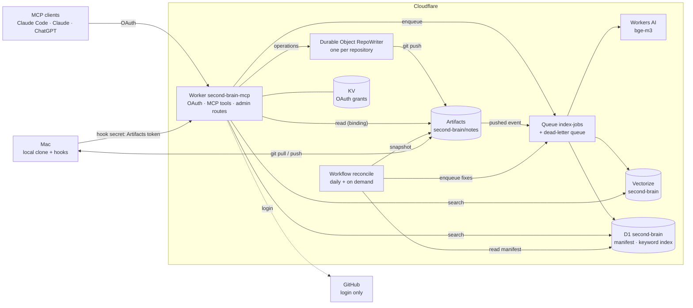
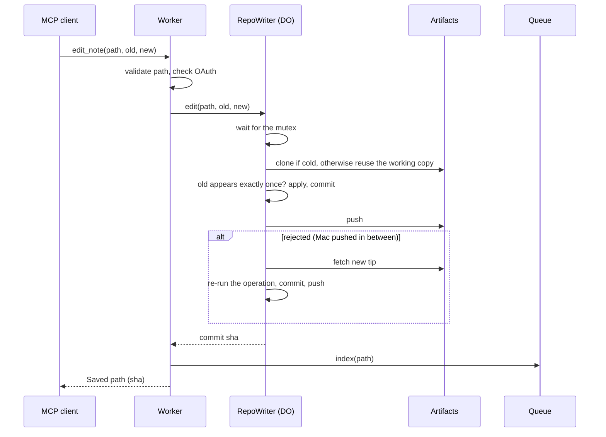

# Spec: Second Brain MCP v2

| | |
|---|---|
| **Status** | Draft: the target for the v2 build. Updated in the same PR as any change that departs from it. |
| **Author** | Yudi Ganeko |
| **Scope** | How v2 works. What changed from v1 is in §11. |
| **PRD** | [PRD v2](../prd/v2.md) |
| **Decisions** | [ADR 002](../adr/002-semantic-search-with-workers-ai-and-vectorize.md), [ADR 005](../adr/005-one-commit-per-edit.md) to [ADR 012](../adr/012-hybrid-search-with-d1-fts5.md) |

## 1. Architecture



| Component | Role | Decided in |
|---|---|---|
| Worker | OAuth server, MCP tools, admin routes | [ADR 011](../adr/011-oauth-with-github-login.md) |
| Artifacts repo `notes` (namespace `second-brain`) | Source of truth, Git history | [ADR 007](../adr/007-cloudflare-artifacts-for-the-notes.md) |
| Durable Object `RepoWriter` | The only Git writer, one per repository | [ADR 008](../adr/008-one-durable-object-per-repository.md) |
| Queue `index-jobs` + `index-jobs-dlq` | The only index writer | [ADR 009](../adr/009-queue-for-indexing-workflow-for-reconciliation.md) |
| Workflow `reconcile` | Daily reconciliation and full rebuild | [ADR 009](../adr/009-queue-for-indexing-workflow-for-reconciliation.md) |
| Vectorize `second-brain` | Semantic index | [ADR 002](../adr/002-semantic-search-with-workers-ai-and-vectorize.md) |
| D1 `second-brain` | Index manifest and keyword index | [ADR 010](../adr/010-index-manifest-in-d1.md), [ADR 012](../adr/012-hybrid-search-with-d1-fts5.md) |
| KV `oauth` | OAuth clients, grants, tokens | [ADR 011](../adr/011-oauth-with-github-login.md) |

## 2. Endpoints

| Route | Method | Auth | What it does |
|---|---|---|---|
| `/mcp` | MCP (Streamable HTTP) | OAuth access token | Serves the tools (§3). Without a valid token: `401` with `WWW-Authenticate` pointing to the resource metadata. |
| `/.well-known/oauth-protected-resource` | `GET` | — | Resource metadata (RFC 9728). |
| `/.well-known/oauth-authorization-server` | `GET` | — | Authorization server metadata. |
| `/authorize` | `GET`, `POST` | — | Consent page with the client name and redirect host; on approval, redirects to GitHub. |
| `/callback` | `GET` | GitHub `code` + `state` | Checks the GitHub user id against `OWNER_GITHUB_ID`, then completes the authorization. |
| `/token`, `/register` | `POST` | — | Token exchange and refresh; client registration (DCR, for compatibility). |
| `/hook/artifacts-token` | `POST` | Hook secret | Returns a 1-hour write token for the notes repository (Mac hook). The hook secret can do nothing else ([#39](https://github.com/YudiG12/second-brain-mcp/issues/39)). |
| `/admin/reconcile` | `POST` | Admin secret | Starts a reconciliation (`?mode=rebuild` for a full rebuild). Returns the Workflow instance id. |
| `/admin/grants` | `GET` | Admin secret | Lists OAuth grants (client, created, last used). |
| `/admin/grants/:id` | `DELETE` | Admin secret | Revokes one grant. |

The admin and hook secrets go in `Authorization: Bearer <secret>`, never in a URL. Under the MCP token prefix only `/mcp` is served. Any other route returns `404`.

## 3. Tools

Same names and inputs as v1, so clients don't need changes; only the output of `search_notes` changes shape.

| Tool | Input | Behavior |
|---|---|---|
| `list_notes` | `prefix?` | Paths of every `.md` note at the head of `main`, optionally under a folder. |
| `read_note` | `path` | The full note. The path is validated like a write ([#30](https://github.com/YudiG12/second-brain-mcp/issues/30)). |
| `search_notes` | `query`, `limit?` (1–20, default 10) | **Hybrid search** (§5.5): keyword and semantic results fused into one ranked list. Returns path, best-matching chunk and `matched` (`keyword`, `semantic` or `both`); may return nothing. If Vectorize or Workers AI fails, it returns the keyword results and says so. v1 returned `path:line: text` lines (§11). |
| `semantic_search` | `query`, `topK?` (1–10, default 5) | Semantic only, as in v1. |
| `save_idea` | `title`, `content` | Creates `ideias/YYYY-MM-DD-<slug>.md` (date in Brasília time). If the file exists, adds `-2`, `-3`… ([#31](https://github.com/YudiG12/second-brain-mcp/issues/31)). An empty slug becomes the first 8 hex characters of the title's SHA-256. |
| `write_note` | `path`, `content` | Creates or overwrites a note. |
| `edit_note` | `path`, `old_text`, `new_text` | Replaces a passage that must appear exactly once, checked inside the writer's lock (§5.1). |
| `delete_note` | `path` | Deletes a note; it stays in history. |
| `move_note` | `from`, `to` | One commit that adds `to` and removes `from`. Fails if `to` exists ([#10](https://github.com/YudiG12/second-brain-mcp/issues/10)). Enqueues both paths. |

**Path rules, for reads and writes:** relative, ends in `.md`, at most 512 bytes, no `..`, no empty or `.` segments, no leading `/`, no backslash or control characters. Paths are compared byte for byte, like Git: case-sensitive and without Unicode normalization (a name typed in NFD on macOS won't match one stored in NFC).

**Write results:** `Saved: <path> (<short sha>)` (or `Edited:`, `Deleted:`, `Moved:`). If the outcome is unknown (§5.1), the tool says so and tells the client to check with `read_note` before retrying.

## 4. Data model

### 4.1 Notes
Markdown files in the Artifacts repository `notes`, branch `main`. Each MCP write is one commit, authored as `second-brain-mcp`, with a message `<operation>: <path>` (`write`, `edit`, `delete`, or `move: <from> -> <to>`). `save_idea` uses a `create` operation, which fails if the note exists and commits as `write`; it tries `-2`, `-3`... up to 20 ([ADR 005](../adr/005-one-commit-per-edit.md)).

### 4.2 Vectors (Vectorize `second-brain`)
As in v1: id `<first 12 bytes of SHA-256(path), hex>-<seq>`, 1024 dimensions (bge-m3), metadata `path`, `seq`, `text` (first 1500 characters). Chunking unchanged: paragraphs packed into chunks of about 1200 characters, at most `MAX_CHUNKS = 50`.

### 4.3 Index manifest (D1, [ADR 010](../adr/010-index-manifest-in-d1.md))
```sql
CREATE TABLE manifest (
  path        TEXT PRIMARY KEY,
  sha         TEXT NOT NULL,     -- Git blob sha of the indexed version
  chunks      INTEGER NOT NULL,
  indexed_at  TEXT NOT NULL      -- ISO 8601, UTC
);
```

### 4.4 Keyword index (D1)
```sql
CREATE VIRTUAL TABLE chunks_fts USING fts5(
  path UNINDEXED, seq UNINDEXED, text,
  tokenize = 'unicode61 remove_diacritics 2',
  prefix = '3'
);
```
One row per chunk, written by the Queue consumer together with the vectors, so keyword search never reads the notes ([#13](https://github.com/YudiG12/second-brain-mcp/issues/13)). The tokenizer ignores case and accents; it matches whole words, so the query uses prefix terms (§5.5). To verify during the build: `remove_diacritics 2` on D1 (fallback: `remove_diacritics 1`). `chunks_fts` and the manifest are derived data and can be rebuilt. `wrangler d1 export` may refuse databases with virtual tables (verify); D1 Time Travel covers the whole database. See [ADR 012](../adr/012-hybrid-search-with-d1-fts5.md).

```sql
CREATE TABLE alerts (
  id          INTEGER PRIMARY KEY,
  source      TEXT NOT NULL,    -- dlq | reconcile
  body        TEXT NOT NULL,    -- the failed message or the report
  created_at  TEXT NOT NULL,
  resolved_at TEXT
);
```

### 4.5 Queue messages (`index-jobs`)
| `type` | Sent by | Fields |
|---|---|---|
| `cf.artifacts.repo.pushed` | Artifacts event subscription (Cloudflare's envelope) | `source.namespace`, `source.repoName`, `payload.ref`, `payload.before`, `payload.after` |
| `index` | Write tools, reconciliation | `path`, `reason` (`write`, `reconcile`, `rebuild`) |
| `drop` | Rebuild | `pathHash` (a path hash with vectors but no source path) |

## 5. Flows

### 5.1 Writing a note

- The mutex is a promise chain inside the object; the operation (not the new content) is sent, so reads and changes happen under the lock ([ADR 008](../adr/008-one-durable-object-per-repository.md)).
- A rejected push is retried up to 3 times, re-running the operation on the new tip each time; after that the tool fails with "busy, try again" and nothing is written.
- Each push has a 15-second timeout, so one slow push can't hold the queue.
- After a push error, timeout or unreadable response, the object fetches the remote head and checks whether its commit **is an ancestor of it** (the Mac may have pushed on top): yes means success, no means failure. Either way the working copy is reset to the remote head. If the fetch fails too, the result is **unknown**: the working copy is dropped (the next write clones), the note is enqueued anyway (indexing reads the head, so it is harmless), and the tool reports "unknown".
- The Artifacts write token comes from `createToken` on the binding and is reused until 5 minutes before it expires.
- Results carry the committed changes, so the caller indexes exactly what was written, not a read-back that could lag.
- After the push, the tool enqueues `index(path)` for each changed path; a failed enqueue doesn't fail the write (the reply says search will catch up, and reconciliation will).

### 5.2 Indexing (Queue consumer)
For each message, **one at a time**, also inside a batch:
1. `cf.artifacts.repo.pushed`: skip unless `payload.ref` is `refs/heads/main`. Diff the trees of `before` and `after` (only changed subtrees) to get the changed paths; `before` of all zeros means every path. Each path is then handled as an `index` message.
2. `index(path)`: read the path at the head of `main`.
   - **Exists:** if the manifest already holds this sha and `reason` isn't `rebuild`, stop (absorbs the duplicate message every MCP write produces). Otherwise chunk, embed, upsert vectors, delete ids `chunks..MAX_CHUNKS-1` left from a longer version, and replace the path's rows in `chunks_fts` (delete and insert in one `db.batch`).
   - **Missing:** delete ids `0..MAX_CHUNKS-1`, the path's `chunks_fts` rows and its manifest row.
3. **Post-write check:** read the head again.
   - After an index: sha unchanged → upsert the manifest row; changed or gone → re-enqueue `index(path)` and record nothing.
   - After a delete: still missing → done; it reappeared → re-enqueue `index(path)`.
4. `drop(pathHash)`: if some path at head hashes to it, re-enqueue that path instead; otherwise delete ids `<pathHash>-0..MAX_CHUNKS-1`.

Failures: `msg.retry({ delaySeconds: 10 * 2^(msg.attempts - 1) })` (10, 20, 40, 80, 160 s), `max_retries: 5`, then `index-jobs-dlq`. The dead-letter consumer (same Worker) writes the message to `alerts` and logs it at error level. Notifying the owner (for example by email) is out of scope for v2 ([#47](https://github.com/YudiG12/second-brain-mcp/issues/47)): the reconciliation fixes the index anyway, and the alerts table keeps the record. Replay: the next reconciliation fixes every affected note anyway; `/admin/reconcile` runs one right away and marks open DLQ alerts resolved when it finishes.

Configuration: `max_batch_size: 10`, `max_concurrency: 1`.

### 5.3 Reconciliation (Workflow `reconcile`)
Started by the Workflow's daily schedule (04:00 UTC, instance ids generated by the platform) or `/admin/reconcile` (id `manual-<mode>-<uuid>`). Two runs can overlap, and that is safe: the Workflow only enqueues, and the Queue consumer is the only writer, re-checking each path at head. A run that errored is restarted with `restart()`.

| Step | Does | Output |
|---|---|---|
| 1. Snapshot source | Head commit of `main`; every `.md` path with its blob sha | `{ commit, notes }` |
| 2. Snapshot index | `SELECT path, sha FROM manifest` and the distinct paths in `chunks_fts`. Rebuild also reads every vector id through `list-vectors` (REST API), grouped by path hash | `{ indexed }` |
| 3. Compare | New, changed and orphan paths (orphans: in the manifest or `chunks_fts` but not in the source), plus notes in the manifest with no `chunks_fts` rows (re-indexed with `reason=rebuild`, not counted toward the alert). Rebuild: every source path, plus path hashes with vectors that no source path produces | lists |
| 4. Enqueue fixes | One step per 20 items: `index(path)` for new, changed and orphan paths (the consumer finds orphans missing and deletes them), with `reason=rebuild` on a rebuild; `drop(pathHash)` for orphan hashes | count |
| 5. Report | Fixed count, excluding paths changed after `commit`. Above 5 on a daily run, writes to `alerts`. Marks open dead-letter alerts resolved | report |

### 5.4 Keeping the Mac in sync
`clients/claude-code/notes-sync.sh`, same hooks as v1, with the Artifacts remote:
- **Token:** `POST /hook/artifacts-token` with the hook secret from the Keychain; the token is cached in the Keychain until 5 minutes before it expires.
- **Pull:** at session start, and on prompts at most every 10 minutes.
- **Push:** at the end of each answer, only if there are local changes or unpushed commits.
- **Lock:** a `mkdir` lock with the owner's pid, around the whole script; a second session waits up to 10 seconds, then skips. A lock older than 2 minutes, or whose pid is gone, is removed. Every skip is written to `~/.claude/notes-sync.log` and to stderr ([#16](https://github.com/YudiG12/second-brain-mcp/issues/16)).
- **No local edit is ever lost** ([#15](https://github.com/YudiG12/second-brain-mcp/issues/15)):
  1. Local edits are committed before bringing in the remote, and local commits are never rewritten: the remote comes in by fast-forward, or by a merge when both sides have new commits (no rebase, no reset).
  2. On a merge conflict, each conflicted note keeps the remote version at its path, and the local version (from the local commit) is saved next to it as `<name>.conflict-<time>.<ext>`. Everything else merges normally; anything written while resolving goes into the merge commit. It pushes and exits 1, so Claude Code shows the conflict.
  3. An interrupted sync leaves a merge in progress; the next run finishes it. A clone left mid-rebase by an older hook is reported and left alone.
  4. Names that differ only in case (`Nota.md`, `nota.md`) are one file on macOS: the writer refuses to create or move a note onto such a name, and the hook stops loudly, committing nothing, if the remote already has both.
  5. History on `main` is therefore not strictly linear: the `RepoWriter`'s check that a push landed walks every parent, not only the first-parent line.
- Git output goes to the log only: nothing on stdout, which some hooks add to Claude's context.

### 5.5 Search
- `semantic_search`: embed the query, query Vectorize, return the top chunks.
- `search_notes` (hybrid, [ADR 012](../adr/012-hybrid-search-with-d1-fts5.md)):
  1. Build the keyword query: split into words, drop Portuguese/English stopwords and terms under 3 characters, keep only letters and digits (so quotes and operators can't reach FTS5), quote each term as a prefix (`"rail"*`) and join with `OR`. No terms left → keyword list is empty.
  2. In parallel: FTS5 `MATCH` on `chunks_fts` (top 50, `bm25` order) and Vectorize (top 50, similarity ≥ 0.30: tuned on real notes, where a full-sentence question scored its best note at 0.44).
  3. Reciprocal rank fusion per chunk: `Σ 1 / (60 + rank)`. A note's score is its best chunk's; return the top `limit` notes with that chunk and `matched`. No note is read.

### 5.6 Authorization
1. The client discovers the server from the `401` and registers (CIMD or DCR). `/authorize` accepts only the MCP connector callbacks of Claude (`https://claude.ai/api/mcp/…`, `https://claude.com/api/mcp/…`) and ChatGPT (`https://chatgpt.com/connector_platform_oauth_redirect`), and loopback on any port (Claude Code); anything else gets `403` and is logged.
2. `/authorize` shows the consent page; on approval, redirects to GitHub with a browser-bound `state`, no scopes.
3. `/callback` reads the user id from `GET /user`; anyone but `OWNER_GITHUB_ID` gets `403` and no grant.
4. The library (`workers-oauth-provider`, pinned 1.x) issues tokens: access 1 hour (`accessTokenTTL`), refresh with a 30-day idle limit (`refreshTokenIdleTTL`). Consent is never remembered. CIMD needs the `global_fetch_strictly_public` compatibility flag.
5. Each MCP request logs the `clientId` and user id (never the token).
6. A daily Cron Trigger (04:30 UTC) calls `purgeExpiredData()` to remove expired grants and tokens and orphans from clients that registered again.
7. `GET /admin/grants` lists the owner's grants (id, client, scope, creation time); `DELETE /admin/grants/<id>` revokes one. Both need the admin secret.

**Migration:** until every client reconnects through OAuth, the old token-prefix URL (`/<MCP_TOKEN>/mcp`) keeps working; it is removed, with the `MCP_TOKEN` secret, at most one week after OAuth is deployed (PRD E4, ADR 011).

## 6. Consistency and concurrency

| Question | Answer |
|---|---|
| Source of truth | Artifacts `main`. Vectorize, `chunks_fts` and the manifest are derived and can be rebuilt. |
| Two MCP writes at once | Serialized by the `RepoWriter` mutex; neither is lost. |
| MCP write and Mac push at once | The later push is rejected; the writer re-runs its operation on the new tip; the Mac rebases on its next push. |
| Read after write | `read_note` reads Artifacts, so it sees the write immediately. Search sees it after the Queue (seconds) plus Vectorize visibility (median under 30 s, up to about 2 min). |
| Stale index entries | Prevented by one consumer, reading at head, and the post-write check; anything missed is fixed by the next reconciliation (at most a day). |

## 7. Security

- MCP: OAuth 2.1 with PKCE, consent page, single GitHub user ([ADR 011](../adr/011-oauth-with-github-login.md)).
- Admin routes: bearer admin secret, which stays off the Mac. The Mac holds only the hook secret, which can only issue Artifacts tokens ([#39](https://github.com/YudiG12/second-brain-mcp/issues/39)).
- Paths validated on every tool; reads go through the Artifacts binding, so no URL can be built from user input.
- Secrets live in Worker secrets and the Mac Keychain, never in the repo or in URLs.
- Note content is data, never instructions: tools return it as text and take no action based on it.

## 8. Configuration and deploy

Declared in `wrangler.jsonc`, created by `scripts/setup.sh` ([ADR 006](../adr/006-wrangler-and-a-setup-script-instead-of-terraform.md)), deployed by CI on merge to `main`.

| Binding / setting | Value |
|---|---|
| `AI` | Workers AI |
| `VECTORIZE` | `second-brain` (1024 dimensions, cosine) |
| `ARTIFACTS` | namespace `second-brain` |
| `WRITER` | Durable Object class `RepoWriter` (SQLite-backed) |
| `INDEX_JOBS` | Queue `index-jobs` (producer and consumer), dead-letter `index-jobs-dlq` (consumer: alerts) |
| `RECONCILE` | Workflow `reconcile`, schedule `0 4 * * *` |
| `DB` | D1 `second-brain` (`manifest`, `chunks_fts`, `alerts`) |
| Compatibility flags | `nodejs_compat` (isomorphic-git), `global_fetch_strictly_public` (CIMD) |
| `OAUTH_KV` | KV namespace `oauth` |
| Var `OWNER_GITHUB_ID` | The owner's numeric GitHub id |
| Vars | `PUBLIC_URL`, `OWNER_GITHUB_ID`, `GITHUB_CLIENT_ID`, `NOTES_REPO`, `VECTORIZE_INDEX`, `CF_ACCOUNT_ID` |
| Secrets | `MCP_TOKEN` (until OAuth), `ADMIN_SECRET`, `HOOK_SECRET`, `GITHUB_CLIENT_SECRET`; optional `CF_API_TOKEN` (Vectorize read): without it, a rebuild re-indexes every note but can't find vectors left without a manifest row |

Workers subdomain: `yudiganeko` (`second-brain-mcp.yudiganeko.workers.dev`).

## 9. Tests (E1, E2)

| Layer | Tool | Covers |
|---|---|---|
| Unit | Vitest | Path rules, chunking (incl. leftover ids, [#11](https://github.com/YudiG12/second-brain-mcp/issues/11)), slugs and suffixes, FTS query building, rank fusion |
| Integration | Vitest with `@cloudflare/vitest-plugin` (Miniflare; formerly `vitest-pool-workers`) | Each tool end to end; Queue consumer (skip, delete, post-write check, retries); Workflow steps; OAuth single-user check and `401` |
| Concurrency | Same pool, `RepoWriter` against a local Git remote | Two concurrent edits to the same note and to different notes both survive ([#5](https://github.com/YudiG12/second-brain-mcp/issues/5)); edit re-checks `old_text` after a rejected push |
| Hook | Shell tests on a temporary clone | Lock, stale lock, conflict copies, exit codes |
| Regression | One per v2 fix | Fails on v1 behavior, passes on v2 |

Tests never load `.dev.vars` and never reach the network: the test Worker is configured in `vitest.config.ts`, and AI, Vectorize and GitHub are stubbed. Node 24 or later (npm 11). CI (GitHub Actions, [#24](https://github.com/YudiG12/second-brain-mcp/issues/24)): typecheck and tests on every PR; merge to `main` deploys. Embedding model choice is benchmarked separately ([#33](https://github.com/YudiG12/second-brain-mcp/issues/33)). On every PR, CI comments a test report (each test linked to its line) and publishes the Vitest UI report at `https://pr-<number>-second-brain-mcp-tests.yudiganeko.workers.dev` (a public URL with the test code; an accepted risk while the repository is still private); `npm run test:ui` opens the same UI locally.

## 10. Measurements (P9)

Measured with `scripts/measure.py` against the live server, from the Mac (network included), 10 runs each; nearest-rank percentiles, indicative at this sample size. One run was excluded (see the JSON). Raw results in [`docs/measurements/`](../measurements/). v2 is filled in after the build ([#14](https://github.com/YudiG12/second-brain-mcp/issues/14)).

| Metric | How | v1 baseline (2026-11-06), p50 / p90 / max | v2 |
|---|---|---|---|
| Write latency (`write_note`) | Tool response time; v1 commits through the GitHub API and indexes inline; v2 pushes through the Durable Object and enqueues indexing | 4.1 / 4.4 / 4.6 s | **2.1 / 2.2 / 5.2 s** (the 5.2 s is the cold first write) |
| Write to searchable (semantic) | Write, then poll `semantic_search` every 3 s | 122 / 162 / 162 s (n = 9, resolution about ±4.5 s) | **53 / 71 / 97 s** |
| Write to searchable (keyword) | Write, then poll `search_notes` for a word only that note has | — (v1 read every note, so immediately) | **15.4 / 15.7 / 20.0 s** |
| `search_notes` | v1: keyword, reads all 28 notes per call; v2: hybrid, reads no note (warm) | 2.8 / 3.1 / 3.1 s | **1.5 / 1.5 / 1.6 s** |
| `semantic_search` | Embed + Vectorize query (warm) | 1.4 / 1.9 / 2.4 s | **1.4 / 1.5 / 1.6 s** |
| Artifacts operations per month | Dashboard, by source | — | _to measure_ (estimate ~3,000) |
| Monthly cost | Billing, all products | not measured (Workers Paid base plan: US$ 5/month) | _to measure_ |

**What v2 changed:** writes are about twice as fast (the tools no longer embed inline) and keyword search no longer reads the notes. A new note shows up in keyword search after about 15 s: the Queue's batch wait plus the consumer, then D1 is visible at once. Semantic search still waits on Vectorize, but less than in v1 (53 s against 122 s at p50; the cause isn't isolated). Monthly cost stays to measure after a week of use ([#14](https://github.com/YudiG12/second-brain-mcp/issues/14)).

**What the baseline shows:** a write itself is fast, but a new note takes about two minutes (up to almost three) to show up in semantic search, even though v1 indexes it inside the write. That delay is most likely Vectorize making new vectors visible (its writes are asynchronous), not the indexing path; this run doesn't isolate the two. It is why ADR 012 adds a D1 keyword index, which is visible as soon as the write commits.

## 11. Changes from v1

| Area | v1 | v2 |
|---|---|---|
| Notes | GitHub repo | Artifacts repo |
| Writes | GitHub REST, one call per file | `RepoWriter` DO, Git push, mutex |
| `move_note` | Two commits | One commit |
| Indexing | Webhook, background, no retry | Queue, single consumer, retries, DLQ |
| Reconciliation | None; `/reindex` only upserts | Daily Workflow; rebuild removes orphans |
| Keyword search | Reads every note per call; substring match per line; `path:line: text` hits | FTS5 in D1, word-prefix match, fused with semantic; returns ranked chunks ([ADR 012](../adr/012-hybrid-search-with-d1-fts5.md)) |
| Auth | Token in the URL | OAuth with GitHub login |
| Mac sync | GitHub remote, pull once a minute, silent failures | Artifacts remote, pull every 10 min, lock, conflict copies, visible errors |
| `read_note` | No path validation | Validated |
| `save_idea` | Overwrites same-day duplicates | Adds a suffix |
| Infra | Created by hand | `wrangler.jsonc` + setup script + CI |

## Related

- [PRD v2](../prd/v2.md)
- [Spec v1](v1.md)
- [ADRs](../adr/)
