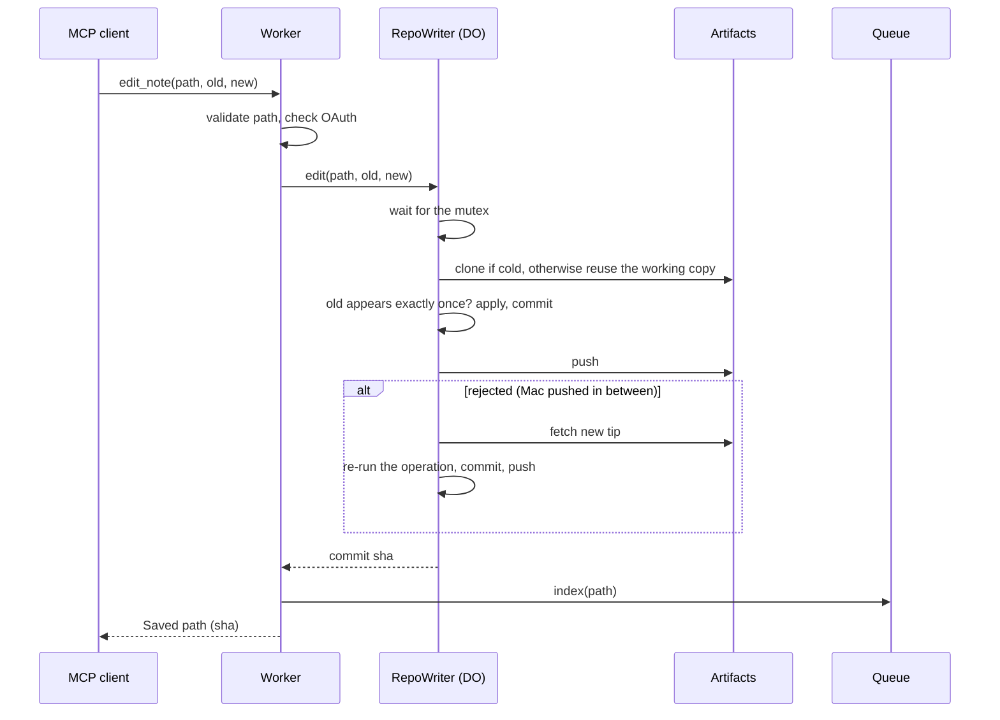

# Spec: Second Brain MCP v2

| | |
|---|---|
| **Status** | Draft: the target for the v2 build. Updated in the same PR as any change that departs from it. |
| **Author** | Yudi Ganeko |
| **Scope** | How v2 works. What changed from v1 is in §10. |
| **PRD** | [PRD v2](../prd/v2.md) |
| **Decisions** | [ADR 002](../adr/002-semantic-search-with-workers-ai-and-vectorize.md), [ADR 005](../adr/005-one-commit-per-edit.md) to [ADR 011](../adr/011-oauth-with-github-login.md) |

## 1. Architecture


| Component | Role | Decided in |
|---|---|---|
| Worker | OAuth server, MCP tools, admin routes | [ADR 011](../adr/011-oauth-with-github-login.md) |
| Artifacts repo `notes` (namespace `second-brain`) | Source of truth, Git history | [ADR 007](../adr/007-cloudflare-artifacts-for-the-notes.md) |
| Durable Object `RepoWriter` | The only Git writer, one per repository | [ADR 008](../adr/008-one-durable-object-per-repository.md) |
| Queue `index-jobs` + `index-jobs-dlq` | The only index writer | [ADR 009](../adr/009-queue-for-indexing-workflow-for-reconciliation.md) |
| Workflow `reconcile` | Daily reconciliation and full rebuild | [ADR 009](../adr/009-queue-for-indexing-workflow-for-reconciliation.md) |
| Vectorize `second-brain` | Semantic index | [ADR 002](../adr/002-semantic-search-with-workers-ai-and-vectorize.md) |
| D1 `second-brain` | Index manifest and keyword index | [ADR 010](../adr/010-index-manifest-in-d1.md), §4.4 |
| KV `oauth` | OAuth clients, grants, tokens | [ADR 011](../adr/011-oauth-with-github-login.md) |

## 2. Endpoints

| Route | Method | Auth | What it does |
|---|---|---|---|
| `/mcp` | MCP (Streamable HTTP) | OAuth access token | Serves the tools (§3). Without a valid token: `401` with `WWW-Authenticate` pointing to the resource metadata. |
| `/.well-known/oauth-protected-resource` | `GET` | — | Resource metadata (RFC 9728). |
| `/.well-known/oauth-authorization-server` | `GET` | — | Authorization server metadata. |
| `/authorize` | `GET`, `POST` | — | Consent page with the client name and redirect host; on approval, redirects to GitHub. |
| `/callback` | `GET` | GitHub `code` + `state` | Checks the GitHub user id against `OWNER_GITHUB_ID`, then completes the authorization. |
| `/token`, `/register` | `POST` | — | Token exchange and refresh; client registration (DCR, for compatibility). |
| `/admin/artifacts-token` | `POST` | Admin secret | Returns a 1-hour write token for the notes repository (Mac hook). |
| `/admin/reconcile` | `POST` | Admin secret | Starts a reconciliation (`?mode=rebuild` for a full rebuild). Returns the Workflow instance id. |
| `/admin/grants` | `GET` | Admin secret | Lists OAuth grants (client, created, last used). |
| `/admin/grants/:id` | `DELETE` | Admin secret | Revokes one grant. |

The admin secret goes in `Authorization: Bearer <secret>`, never in a URL. Any other route returns `404`.

## 3. Tools

Same names and inputs as v1, so clients don't change.

| Tool | Input | Behavior |
|---|---|---|
| `list_notes` | `prefix?` | Paths of every `.md` note at the head of `main`, optionally under a folder. |
| `read_note` | `path` | The full note. The path is validated like a write ([#30](https://github.com/YudiG12/second-brain-mcp/issues/30)). |
| `search_notes` | `query`, `limit?` (1–20, default 10) | **Hybrid search** (§5.5): keyword and semantic results fused into one ranked list. Returns path, matching snippet and score. |
| `semantic_search` | `query`, `topK?` (1–10, default 5) | Semantic only, as in v1. |
| `save_idea` | `title`, `content` | Creates `ideias/YYYY-MM-DD-<slug>.md`. If the file exists, adds `-2`, `-3`… ([#31](https://github.com/YudiG12/second-brain-mcp/issues/31)). An empty slug becomes the first 8 hex characters of the title's SHA-256. |
| `write_note` | `path`, `content` | Creates or overwrites a note. |
| `edit_note` | `path`, `old_text`, `new_text` | Replaces a passage that must appear exactly once, checked inside the writer's lock (§5.1). |
| `delete_note` | `path` | Deletes a note; it stays in history. |
| `move_note` | `from`, `to` | One commit that adds `to` and removes `from`. Fails if `to` exists ([#10](https://github.com/YudiG12/second-brain-mcp/issues/10)). |

**Path rules, for reads and writes:** relative, ends in `.md`, at most 512 bytes, no `..`, no empty or `.` segments, no leading `/`, no backslash or control characters.

**Write results:** `Saved <path> (<short sha>)`. If the outcome is unknown (§5.1), the tool says so and tells the client to check with `read_note` before retrying.

## 4. Data model

### 4.1 Notes
Markdown files in the Artifacts repository `notes`, branch `main`. Each MCP write is one commit, authored as `second-brain-mcp`, with a message `<tool>: <path>` ([ADR 005](../adr/005-one-commit-per-edit.md)).

### 4.2 Vectors (Vectorize `second-brain`)
As in v1: id `<first 12 bytes of SHA-256(path), hex>-<seq>`, 1024 dimensions (bge-m3), metadata `path`, `seq`, `text` (first 1500 characters). Chunking unchanged: paragraphs packed into chunks of about 1200 characters, at most `MAX_CHUNKS = 50`.

### 4.3 Index manifest (D1, [ADR 010](../adr/010-index-manifest-in-d1.md))
```sql
CREATE TABLE manifest (
  path        TEXT PRIMARY KEY,
  sha         TEXT NOT NULL,     -- Git blob sha of the indexed version
  chunks      INTEGER NOT NULL,
  indexed_at  TEXT NOT NULL      -- ISO 8601, UTC
);
```

### 4.4 Keyword index (D1)
```sql
CREATE VIRTUAL TABLE chunks_fts USING fts5(
  path UNINDEXED, seq UNINDEXED, text,
  tokenize = 'unicode61 remove_diacritics 2'
);
```
One row per chunk, written by the Queue consumer together with the vectors, so keyword search never reads the notes ([#13](https://github.com/YudiG12/second-brain-mcp/issues/13)). The tokenizer ignores case and accents, like v1's keyword search.

### 4.5 Queue messages (`index-jobs`)
| Shape | Sent by | Fields |
|---|---|---|
| `pushed` | Artifacts event subscription | `repo`, `ref`, `before`, `after` |
| `index` | Write tools, reconciliation | `path`, `reason` (`write`, `reconcile`, `rebuild`) |
| `drop` | Rebuild | `ids` (orphan vector ids found by `list-vectors`) |

## 5. Flows

### 5.1 Writing a note

- The mutex is a promise chain inside the object; the operation (not the new content) is sent, so reads and changes happen under the lock ([ADR 008](../adr/008-one-durable-object-per-repository.md)).
- A rejected push is retried up to 3 times, re-running the operation on the new tip each time.
- After a push error or unreadable response, the object reads the remote head: if the commit is there, it is a success; if the check fails too, the result is **unknown**. The working copy is reset to the remote head either way.
- The Artifacts write token comes from `createToken` on the binding and is reused until 5 minutes before it expires.

### 5.2 Indexing (Queue consumer)
For each message, **one at a time**, also inside a batch:
1. `pushed`: skip unless `ref` is `refs/heads/main`. Diff the trees of `before` and `after` (only changed subtrees) to get the changed paths; `before` of all zeros means every path. Each path is then handled as an `index` message.
2. `index(path)`: read the path at the head of `main`.
   - **Exists:** if the manifest already holds this sha, stop (absorbs the duplicate message every MCP write produces). Otherwise chunk, embed, upsert vectors, replace the path's rows in `chunks_fts`, and delete ids `chunks..MAX_CHUNKS-1` left from a longer version.
   - **Missing:** delete ids `0..MAX_CHUNKS-1`, the `chunks_fts` rows and the manifest row.
3. **Post-write check:** read the head again. If the path's sha is unchanged, upsert the manifest row; otherwise re-enqueue `index(path)` and record nothing.
4. `drop(ids)`: delete those vector ids.

Failures: `msg.retry({ delaySeconds: 10 * 2^attempts })`, `max_retries: 5`, then `index-jobs-dlq`. The dead-letter consumer logs at error level and writes the message to an `alerts` table in D1; `/admin/reconcile` replays them.

Configuration: `max_batch_size: 10`, `max_concurrency: 1`.

### 5.3 Reconciliation (Workflow `reconcile`)
Started by the Workflow's daily schedule (04:00 UTC) or `/admin/reconcile`. Instance id `reconcile-YYYY-MM-DD` (or `-rebuild-<timestamp>`), so two runs never overlap.

| Step | Does | Output |
|---|---|---|
| 1. Snapshot source | Head commit of `main`; every `.md` path with its blob sha | `{ commit, notes }` |
| 2. Snapshot index | `SELECT path, sha FROM manifest` (rebuild: `list-vectors` through the REST API, grouped by path hash) | `{ indexed }` |
| 3. Compare | New, changed and orphan paths | three lists |
| 4. Enqueue fixes | One step per 20 paths: `index(path)` for each (orphans too: the consumer finds them missing and deletes); rebuild: `drop(ids)` for vector ids that no source path produces | count |
| 5. Report | Fixed count, excluding paths changed after `commit` | logged; error level if more than 5 |

### 5.4 Keeping the Mac in sync
`clients/claude-code/notes-sync.sh`, same hooks as v1, with the Artifacts remote:
- **Token:** `POST /admin/artifacts-token` with the admin secret from the Keychain; the token is cached in the Keychain until 5 minutes before it expires.
- **Pull:** at session start, and on prompts at most every 10 minutes.
- **Push:** at the end of each answer, only if there are local changes or unpushed commits.
- **Lock:** a `mkdir` lock around the whole script; a second session waits up to 10 seconds, then skips ([#16](https://github.com/YudiG12/second-brain-mcp/issues/16)).
- **Conflicts:** if a rebase stops, abort it, save the local version as `<note>.conflict-<date>.md`, take the remote version, and exit non-zero so Claude Code shows the hook error ([#15](https://github.com/YudiG12/second-brain-mcp/issues/15)).

### 5.5 Search
- `semantic_search`: embed the query, query Vectorize, return the top chunks.
- `search_notes` (hybrid): run in parallel an FTS5 `MATCH` on `chunks_fts` (top 20, `bm25` order) and a Vectorize query (top 20). Fuse with reciprocal rank fusion: `score = Σ 1 / (60 + rank)` over both lists, grouped by path, best chunk as the snippet. No note is read.

### 5.6 Authorization
1. The client discovers the server from the `401` and registers (CIMD or DCR; redirect hosts limited to claude.ai, chatgpt.com and loopback).
2. `/authorize` shows the consent page; on approval, redirects to GitHub with a browser-bound `state`, no scopes.
3. `/callback` reads the user id from `GET /user`; anyone but `OWNER_GITHUB_ID` gets `403` and no grant.
4. The library issues tokens: access 1 hour, refresh with a 30-day idle limit.
5. Each tool call logs `clientId` and grant id with the operation.

## 6. Consistency and concurrency

| Question | Answer |
|---|---|
| Source of truth | Artifacts `main`. Vectorize, `chunks_fts` and the manifest are derived and can be rebuilt. |
| Two MCP writes at once | Serialized by the `RepoWriter` mutex; neither is lost. |
| MCP write and Mac push at once | The later push is rejected; the writer re-runs its operation on the new tip; the Mac rebases on its next push. |
| Read after write | `read_note` reads Artifacts, so it sees the write immediately. Search sees it after the Queue (seconds) plus Vectorize visibility (median under 30 s, up to about 2 min). |
| Stale index entries | Prevented by one consumer, reading at head, and the post-write check; anything missed is fixed by the next reconciliation (at most a day). |

## 7. Security

- MCP: OAuth 2.1 with PKCE, consent page, single GitHub user ([ADR 011](../adr/011-oauth-with-github-login.md)).
- Admin routes: bearer admin secret; it also issues Artifacts tokens and revokes grants until [#39](https://github.com/YudiG12/second-brain-mcp/issues/39).
- Paths validated on every tool; reads go through the Artifacts binding, so no URL can be built from user input.
- Secrets live in Worker secrets and the Mac Keychain, never in the repo or in URLs.
- Note content is data, never instructions: tools return it as text and take no action based on it.

## 8. Configuration and deploy

Declared in `wrangler.jsonc`, created by `scripts/setup.sh` ([ADR 006](../adr/006-wrangler-and-a-setup-script-instead-of-terraform.md)), deployed by CI on merge to `main`.

| Binding / setting | Value |
|---|---|
| `AI` | Workers AI |
| `VECTORIZE` | `second-brain` (1024 dimensions, cosine) |
| `ARTIFACTS` | namespace `second-brain` |
| `WRITER` | Durable Object class `RepoWriter` (SQLite-backed) |
| `INDEX_JOBS` | Queue `index-jobs`, dead-letter `index-jobs-dlq` |
| `RECONCILE` | Workflow `reconcile`, schedule `0 4 * * *` |
| `DB` | D1 `second-brain` (manifest, `chunks_fts`, alerts) |
| `OAUTH_KV` | KV namespace `oauth` |
| Var `OWNER_GITHUB_ID` | The owner's numeric GitHub id |
| Secrets | `ADMIN_SECRET`, `GITHUB_CLIENT_ID`, `GITHUB_CLIENT_SECRET`, `COOKIE_ENCRYPTION_KEY`, `CF_API_TOKEN` (Vectorize read, for rebuilds) |

Workers subdomain: `yudiganeko` (`second-brain-mcp.yudiganeko.workers.dev`).

## 9. Measurements (P9)

Filled in during the build ([#14](https://github.com/YudiG12/second-brain-mcp/issues/14)):

| Metric | How | Result |
|---|---|---|
| Write latency, warm and cold | Timestamps in `RepoWriter` | _to measure_ |
| Write to searchable | Write, then poll `semantic_search` | _to measure_ |
| Artifacts operations per month | Dashboard, by source | _to measure_ (estimate ~3,000) |
| Monthly cost | Billing, all products | _to measure_ |

## 10. Changes from v1

| Area | v1 | v2 |
|---|---|---|
| Notes | GitHub repo | Artifacts repo |
| Writes | GitHub REST, one call per file | `RepoWriter` DO, Git push, mutex |
| `move_note` | Two commits | One commit |
| Indexing | Webhook, background, no retry | Queue, single consumer, retries, DLQ |
| Reconciliation | None; `/reindex` only upserts | Daily Workflow; rebuild removes orphans |
| Keyword search | Reads every note per call | FTS5 in D1, fused with semantic |
| Auth | Token in the URL | OAuth with GitHub login |
| Mac sync | GitHub remote, pull once a minute, silent failures | Artifacts remote, pull every 10 min, lock, conflict copies, visible errors |
| `read_note` | No path validation | Validated |
| `save_idea` | Overwrites same-day duplicates | Adds a suffix |
| Infra | Created by hand | `wrangler.jsonc` + setup script + CI |

## Related

- [PRD v2](../prd/v2.md)
- [Spec v1](v1.md)
- [ADRs](../adr/)
